  
    

  

   

  
  
  

    

  
  

---

## Tech Stack & Engineering Arsenal

<table align="center" width="100%">
  <tr>
    <td align="center" width="25%">
      <b>Core Languages</b>  
      
    </td>
    <td align="center" width="25%">
      <b>Frameworks &amp; UI</b>  
      
    </td>
    <td align="center" width="25%">
      <b>Data &amp; Persistence</b>  
      
    </td>
    <td align="center" width="25%">
      <b>Systems &amp; Tooling</b>  
      
    </td>
  </tr>
</table>

---

## Featured Engineering Projects

| Project | Domain & Paradigm | Core Stack | Architectural Highlights |
| :--- | :--- | :--- | :--- |
| **[AetherHub](https://github.com/dzakiy-k/aetherhub)** | Polyglot File Transit & Media Studio |    | 6-digit code LAN/Tunnel file transit (`QuickDrop`), two-way QR device pairing, PDF Forge & digital e-Sign with ink color conversion, AI Background Remover (`rembg` + OpenCV defringing), HD Image Enhancer, Smart OCR, and QR Code Generator/Scanner. |
| **[Dhiva Academic Portal](https://github.com/dzakiy-k/dhiva-academic-portal)** | Multi-Role E-Learning & Academic ERP |    | Multi-role RBAC portal (`Admin`, `Guru`, `Siswa`), integrated OpenAI student academic assistant, automated Excel attendance/financial exports, PPDB enrollment verification, and dynamic class scheduling. |
| **[Celestielle Bakery POS](https://github.com/dzakiy-k/celestielle-bakery-pos)** | Enterprise Architecture BPMN & POS |    | Executable 9-step BPMN 2.0 & IPO (Input-Process-Output) state machine across 3 operational swimlanes (Self-Service Customer Etalase, Touch POS Cashier Terminal with QRIS/Cash checkout, and Automated Inventory & Revenue Analytics). |
| **[Smart Mosque Ecosystem](https://github.com/dzakiy-k/smart-mosque-app)** | Offline-First Digital Signage & Governance |    | Offline-first 16:9 Smart TV Digital Signage with IndexedDB caching, astronomical prayer calculations (`adhan`), Web Audio API alert synthesizer, Screen WakeLock management, and DKM administrative dashboard. |

---

## Telemetry & Engineering Metrics

  
   
  
  
  

